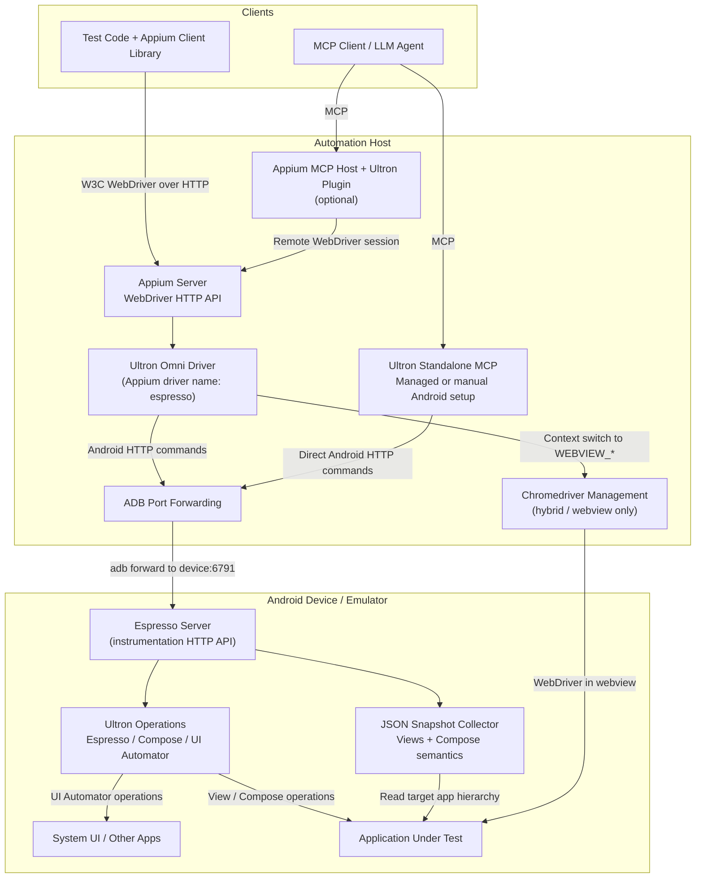

---
hide:
  - navigation

title: Overview
---

Ultron Omni Driver is an independent fork of Appium Espresso Driver for grey-box automation of
native and hybrid Android applications. It supports Appium 3 clients and agent access through
standalone MCP or an Appium MCP plugin.

## What Ultron adds

[Ultron](https://open-tool.github.io/ultron/docs/) is a testing framework built on Espresso,
Compose Test APIs and UI Automator. The fork integrates its operations, supported retries and
lifecycle listeners, and adds JSON observations and remote APIs around them.

Explicit Ultron actions/assertions return an operation result together with a snapshot captured
after execution, including execution failures. Mixed snapshots show Views and embedded Compose
semantics in one tree. Dedicated RecyclerView and Compose operations let clients express list
interactions and checks on Android. These APIs also work through the
[Ultron MCP server](https://github.com/dabrynskiy/ultron-omni-driver/blob/master/packages/ultron-mcp/README.md).

See [Comparison with Appium Espresso Driver](comparison.md) for the additions, usage example and
limits, and the [Ultron source](https://github.com/open-tool/ultron) for the underlying framework.

## Key Design Principle

Most other Appium drivers such as [UiAutomator2](https://appium.github.io/appium-uiautomator2-driver/)
are used for black-box testing, so before using the Espresso driver, it is critical to understand
how its grey-box approach is different.

Grey-box testing is more closely coupled to the app under test than black-box testing, which means
two things:

* The Espresso driver can access in-depth information about the app under test that is not exposed
  to black-box drivers: off-screen elements, element tag values, use of [IdlingResource](https://developer.android.com/reference/androidx/test/espresso/IdlingResource),
  and more
* Instrumentation must use dependencies compatible with the app under test. Knowing the tool
  and dependency versions used to build that app helps prepare a compatible server; source
  access is useful but is not required by the driver's interface.

In Appium mode, the driver builds its helper application (the Espresso server) using Android
application tools and dependencies, then installs this server on the device. Incompatible
dependencies between the app and the server can prevent session creation or cause runtime errors.

For Appium sessions, use the
[`appium:espressoBuildConfig`](./reference/capabilities.md#espressobuildconfig) capability when
the server's default dependencies need to be aligned with the app. Standalone MCP uses a
prebuilt instrumentation APK with compatible dependencies and a matching signing certificate;
managed startup installs and starts it, but does not build or sign it.

## Target Platforms

The driver supports the following Android platforms as automation targets:

|Platform|Simulators|Real devices|
|--|--|--|
|Android|:white_check_mark:|:white_check_mark:|
|Android TV|:white_check_mark:|:question: [^untested]|
|Android Wear / Wear OS|:white_check_mark:|:question: [^untested]|
|Android XR|:white_check_mark:|:question: [^untested]|
|Android Auto|:x:|:x:|
|Android Automotive|:white_check_mark:|:question: [^untested]|

## Contexts

The following application contexts are supported for automation:

* Native applications
* Webviews based on Chrome
* Hybrid applications

## Technologies Used

In Appium mode, the driver uses the [W3C WebDriver protocol](https://www.w3.org/TR/webdriver/) for
session management. Standalone MCP connects directly to the instrumentation HTTP API. Both paths
share the Android server and its Ultron execution layer:

* Native testing
    * Based on Android's [Espresso testing library](https://developer.android.com/training/testing/espresso/)
    * Uses [Ultron](https://open-tool.github.io/ultron/docs/) operation execution over Espresso,
      Compose Test APIs and UI Automator
    * Provided by the bundled Espresso server application
* Agent observation and control
    * Mixed View/Compose JSON snapshots and explicit action/assertion APIs
    * Standalone MCP server or optional Appium MCP plugin
* Webview testing
    * Based on [the ChromeDriver server](https://developer.chrome.com/docs/chromedriver)
    * Provided by the [`appium-chromedriver`](https://github.com/appium/appium-chromedriver) library
* Additional tools
    * Support for `adb` is handled by the [`appium-adb`](https://github.com/appium/appium-adb) library
    * Management of certain Android settings is handled by the [`io.appium.settings`](https://github.com/appium/io.appium.settings) library

Several libraries and other features are shared with [the Appium UiAutomator2 driver](https://appium.github.io/appium-uiautomator2-driver/),
as part of the [`appium-android-driver`](https://github.com/appium/appium-android-driver) library.

## End-to-End Architecture

Appium clients and the optional Appium MCP plugin use the WebDriver path. Standalone MCP bypasses
Appium and connects to the same instrumentation HTTP server through ADB forwarding. Its managed
mode installs a prebuilt signed APK, starts instrumentation, creates a session and cleans up owned
resources on close. Manual Android preparation is also supported.

In Appium mode, the driver handles server build, signing, installation and startup. The diagram
shows the shared command path after preparation. Chromedriver management is part of the Appium
WebView path; the mixed JSON snapshot covers the target app's Views and Compose semantics.
System UI automation uses the UI Automator path and is outside that snapshot API.

[^untested]: Not tested
