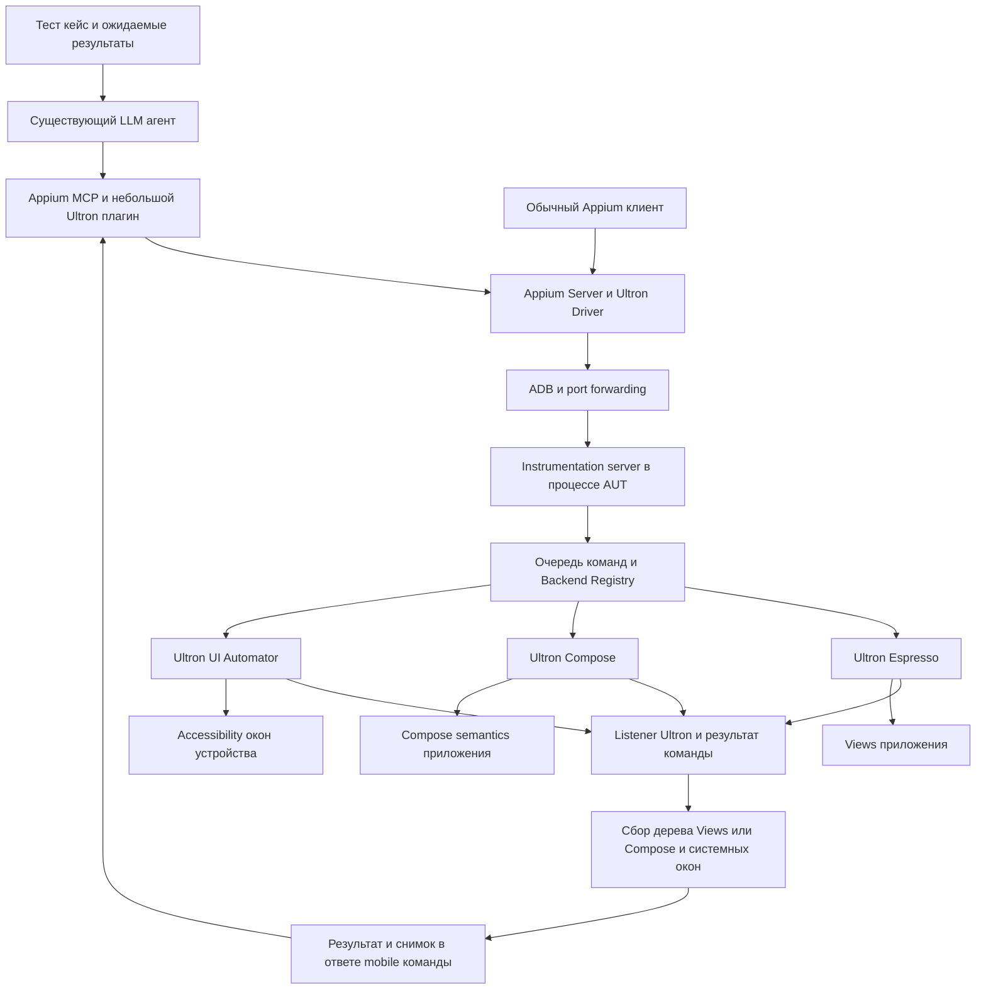

Дата: 30 октября 2026 года. База анализа: локальный форк `appium-espresso-driver` 9.3.10, коммит `da8a398`, документация Ultron и исходники тега 2.6.5.

MVP — отдельный Android-драйвер для Appium 3 с `appium:automationName=Ultron`. Главная функция: выполнить синхронизированную операцию через Ultron, обработать допустимые временные ошибки и вернуть LLM результат вместе с внутренним деревом интерфейса, собранным после операции. Для Views используется Ultron Espresso, для Compose — Ultron Compose, для системного интерфейса — Ultron UI Automator.

Базовый способ запуска соответствует Espresso Driver: клиент передаёт APK и capabilities; драйвер подготавливает отдельный instrumentation APK под приложение. Гибрид работает внутри одной сессии и одного instrumentation-процесса. Библиотечную интеграцию в `androidTest` сохранить как резервный путь подключения сложного AUT; отдельный удобный процесс её поставки можно завершить после MVP. Независимый от процесса приложения режим UI Automator — следующее расширение.

LLM подключается через существующий [Appium MCP](https://github.com/appium/appium-mcp) в remote mode. Небольшой плагин экспортирует новые команды драйвера через публичный `appium-mcp/core` и `getDriver()`. Собственный MCP-сервер, модель и полноценный runner тест-кейсов не входят в MVP.

## Что означает использование Ultron

Ultron построен поверх Espresso, Compose Test API и UI Automator. Для Views переход на Ultron сохраняет Espresso как низкоуровневый механизм. Ultron добавляет операции, assertions, управляемые повторы, работу со списками и события жизненного цикла. Поэтому обещание полностью устранить Espresso или его ограничения было бы неверным. [Архитектура Ultron](https://open-tool.github.io/ultron/docs/).

Ценность MVP — сочетание синхронизации Espresso/Compose, зарегистрированных IdlingResource, управляемых повторов Ultron и возврата связанного с операцией снимка UI через listener. LLM получает готовый результат и новое наблюдение за одно обращение. Преимущество нужно измерять на числе ошибочных действий, обращений к модели и успешных проверок, а не только на числе выполненных кликов.

Удачный первый сценарий: выполнение описанных человеком тест-кейсов на Android Views, Compose и смешанных экранах, с переходами через системные диалоги. Доступ к исходникам приложения не является обязательным условием интерфейса драйвера, но знание зависимостей и возможность подготовить совместимую тестовую сборку заметно повышают вероятность успешного подключения.

## Что уже есть в форке

| Область | Реализация | Как использовать |
| --- | --- | --- |
| Appium, capabilities и сессии | [`lib/driver.ts`](../lib/driver.ts), [`package.json`](../package.json) | Сохранить внешний каркас и выделить идентичность нового драйвера |
| Сборка, подпись, установка, запуск instrumentation и HTTP proxy | [`lib/commands/server/runner.ts`](../lib/commands/server/runner.ts), [`builder.ts`](../lib/commands/server/builder.ts), [`app-install.ts`](../lib/commands/app-install.ts) | Адаптировать под Ultron и проверять совместимость сервера при старте |
| HTTP server и маршрутизация на устройстве | [`ServerBase.kt`](../espresso-server/library/src/main/java/io/appium/espressoserver/lib/http/ServerBase.kt), [`Router.kt`](../espresso-server/library/src/main/java/io/appium/espressoserver/lib/http/Router.kt) | Сохранить транспорт, добавить диспетчер операций |
| Views и Compose | [`RequestHandler.kt`](../espresso-server/library/src/main/java/io/appium/espressoserver/lib/handlers/RequestHandler.kt), [`ComposeHandlerBridge.kt`](../espresso-server/library/src/composeOn/java/io/appium/espressoserver/lib/compose/ComposeHandlerBridge.kt) | Ввести адаптеры выполнения без полного переписывания обработчиков |
| UI Automator | [`Uiautomator.kt`](../espresso-server/library/src/main/java/io/appium/espressoserver/lib/handlers/Uiautomator.kt), [`UiautomatorPageSource.kt`](../espresso-server/library/src/main/java/io/appium/espressoserver/lib/handlers/UiautomatorPageSource.kt) | Использовать как отправную точку гибрида; заменить исполнение на Ultron и добавить строгий выбор цели |
| Дерево Views и Compose | [`SourceDocument.kt`](../espresso-server/library/src/main/java/io/appium/espressoserver/lib/model/SourceDocument.kt), [`SourceDocumentComposeHooks.kt`](../espresso-server/library/src/composeOn/java/io/appium/espressoserver/lib/model/SourceDocumentComposeHooks.kt) | Сохранить XML для Appium, добавить отдельную JSON-модель для LLM |
| Ссылки на элементы | [`Element.kt`](../espresso-server/library/src/main/java/io/appium/espressoserver/lib/model/Element.kt), [`EspressoViewsCache.kt`](../espresso-server/library/src/main/java/io/appium/espressoserver/lib/helpers/EspressoViewsCache.kt), [`ComposeViewCache.kt`](../espresso-server/library/src/composeOn/java/io/appium/espressoserver/lib/helpers/ComposeViewCache.kt) | Сохранить W3C element ID, отдельно реализовать ссылки из снимка с проверкой актуальности |
| Расширения Appium | [`lib/execute-method-map.ts`](../lib/execute-method-map.ts) | Добавить `mobile: ultronSnapshot`, `mobile: ultronAct`, `mobile: ultronAssert` |
| Сервер как библиотека | [Существующая инструкция](guides/usage-as-library.md) | Использовать для приложения со сложной конфигурацией зависимостей |
| WebView | [`lib/commands/context.ts`](../lib/commands/context.ts), [hybrid mode](guides/hybrid.md) | Сохранить существующий путь через Chromedriver; расширять после native MVP |

В текущей реализации `DriverContext` переключает глобальную стратегию между Espresso и Compose. UI Automator доступен отдельной командой, а не полноценным третьим backend. Кэши Views и Compose раздельные. Следовательно, готовые низкоуровневые возможности уже есть, но единую модель элементов и маршрутизацию предстоит добавить.

Есть конкретная особенность для исправления: существующий `mobile: uiautomator` без параметра `index` выполняет действие для **всех** найденных объектов. Это неприемлемый контракт для одиночного действия LLM. Новый API при нескольких совпадениях должен возвращать ошибку неоднозначности; действие над коллекцией должно задаваться отдельно.

## Варианты продукта

| Вариант | Сильная сторона | Ограничение | Решение |
| --- | --- | --- | --- |
| MCP поверх существующего Espresso Driver | Быстрее всего проверить полезность LLM API | Сам по себе не использует Ultron | Использовать как baseline для сравнения |
| Форк с Ultron и гибридом внутри AUT | Переиспользует Appium и даёт доступ к Views, Compose и системному UI | Зависит от подключения instrumentation к AUT | Основной MVP |
| Ultron server в сборке приложения | Зависимости согласуются вместе с AUT, проще подключать собственные операции | Нужна интеграция в Gradle-проект | Дополнительный способ поставки того же сервера |
| Независимый UI Automator server | Подходит произвольным APK, продолжает работать при перезапуске AUT | Нет прямого доступа к Views и Compose semantics внутри AUT | Следующий режим сессии |
| Собственный транспорт без Appium | Можно полностью подстроить протокол под агента | Придётся заново решать установку, сессии, устройства и совместимость клиентов | Не оправдан для первого этапа |

Отдельный драйвер концентрирует новый исполнитель и получение внутреннего UI. Существующий Appium MCP обеспечивает внешний интерфейс для агента и позволяет не расширять MVP до отдельной платформы orchestration. Исходный Espresso Driver остаётся baseline: он уже поддерживает прямой доступ к Compose и часть UI Automator, поэтому выигрыш нового драйвера нужно проверять отдельно.

## Архитектура гибрида



Предлагаемая внутренняя граница — `AutomationBackend`: поиск, чтение свойств, действие, assertion и сбор дерева. Реализации: `views`, `compose`, `uiautomator`. Registry публикует фактически поддерживаемые операции каждого backend. WebView остаётся унаследованным Appium context и не входит в гарантированное покрытие MVP.

### Маршрутизация операций

1. Клиент может явно указать backend в селекторе. Это основной способ первоначальной реализации и отладки.
2. Элемент, возвращённый снимком, хранит владельца backend. Последующий `act(ref)` направляется этому владельцу без повторного выбора со стороны LLM.
3. Для UI своего приложения предпочтительны Views или Compose. Для permission dialog, системного picker и чужого приложения используется UI Automator.
4. Если одна кнопка видна и через Compose, и через accessibility, нельзя автоматически считать их разными целями. В MVP можно возвращать раздельные деревья с указанием источника, без попытки полностью объединить их.
5. После ошибки действия другой backend не пробует выполнить его повторно автоматически. Сначала выясняется состояние предыдущей команды и заново наблюдается UI.

Такой гибрид добавляет ограниченную сложность на уровне отдельных операций. Основные затраты связаны с единым снимком, временем жизни ссылок, идентичностью узлов и обработкой ошибок. Оценивать их следует отдельно от подключения Ultron UI Automator.

UI Automator может управлять другими приложениями и системными окнами через accessibility. Это не означает, что он видит все внутренние узлы Compose или произвольный Canvas. [Возможности UI Automator](https://developer.android.com/training/testing/other-components/ui-automator).

### Жизненный цикл

В MVP сервер находится в instrumentation-процессе AUT. Переход в системный диалог обычно сохраняет доступ к серверу, пока процесс жив. Падение, force-stop или некоторые сценарии перезапуска AUT могут оборвать всю сессию, включая UI Automator. Очередь и журнал на хосте должны переживать такую потерю соединения и фиксировать неизвестный результат незавершённой команды.

Для независимого режима позже можно запускать instrumentation в собственном helper-приложении. Оно использует Ultron UI Automator для управления целевым APK снаружи и не требует подписи AUT тем же ключом. Прямые операции Views и Compose в таком режиме недоступны. Переключение между helper instrumentation и AUT instrumentation потребует отдельной координации; одновременный запуск второго Appium-драйвера не следует считать готовым механизмом fallback.

## Плюсы выбранного подхода

- **Повторное использование Appium.** Клиенты, сессии, ADB, установка APK, capabilities, screenshot и часть диагностики уже реализованы.
- **Глубина доступа.** Views и Compose доступны через тестовые API, включая свойства, которые могут отсутствовать в accessibility.
- **Синхронизация внутри приложения.** Операции используют синхронизацию Espresso/Compose и зарегистрированные IdlingResource. Повторы Ultron обрабатывают согласованный набор временных ошибок; модель не управляет каждым ожиданием самостоятельно.
- **Системные переходы.** UI Automator закрывает разрешения, picker, уведомления и другие окна без смены драйвера.
- **Операции Ultron.** Работа с RecyclerView и LazyList может уменьшить число низкоуровневых действий и обращений к LLM. Для виртуализированных списков поиск всё равно может требовать прокрутки. [RecyclerView](https://open-tool.github.io/ultron/docs/android/recyclerview/), [LazyList](https://open-tool.github.io/ultron/docs/compose/lazylist/).
- **Состояние после операции.** Listener связывает результат и исключения с командой, а сборщик добавляет дерево экрана в тот же ответ. Это уменьшает необходимость отдельного запроса наблюдения и служит основой диагностики. [Listeners](https://open-tool.github.io/ultron/docs/common/listeners/).
- **Общий исполнитель.** Один и тот же сценарий можно исследовать с LLM, а после фиксации селекторов и assertions воспроизводить без модели.

## Минусы и ограничения

### Подключение к приложению

Instrumentation APK должен быть совместим с AUT. В штатном сценарии Espresso Driver используются совместимые подписи; форк умеет переподписывать APK приложения. Переподпись может нарушить signature permissions, интеграции, проверяющие сертификат, или проверки целостности. `noSign` не отменяет требований подключения instrumentation. Не следует обещать универсальный запуск любого APK в режиме прямого доступа к Views и Compose. [Подпись и startup](troubleshooting/startup.md), [noSign](reference/capabilities.md#nosign).

Standalone server не обязательно требует изменений исходников AUT. Однако Kotlin, Compose, AndroidX Test и runtime-зависимости могут конфликтовать. Для таких приложений сборка сервера в том же Gradle-проекте — практичный дополнительный путь.

Текущий `ServerBase` открывает HTTP socket в процессе AUT и требует `android.permission.INTERNET` у приложения. Для APK без этого разрешения потребуется другой транспорт или подготовка тестовой сборки. Само подключение Ultron это ограничение не меняет.

### Зависимости и JVM

| Компонент | Локальный форк | Исходники Ultron 2.6.5 |
| --- | --- | --- |
| Kotlin | 2.4.20 | 2.2.21 |
| Compose UI Test | 1.12.1 | 1.10.0 |
| Espresso | 3.7.0 | 3.7.0 |
| UI Automator | 2.4.0 | 2.2.0 |
| Объявленные версии Android Gradle Plugin | 9.4.1 | 8.9.3 в каталоге, 8.3.1 в legacy buildSrc |
| JVM target модуля | 1.8 в настройках форка | Java 11 для `ultron-android` |

Версии форка взяты из [`libs.versions.toml`](../espresso-server/gradle/libs.versions.toml) и [`gradle.properties`](../espresso-server/gradle.properties); версии Ultron — из [Versions.kt тега 2.6.5](https://github.com/open-tool/ultron/blob/2.6.5/buildSrc/src/main/kotlin/Versions.kt), [каталога версий](https://github.com/open-tool/ultron/blob/2.6.5/gradle/libs.versions.toml) и [сборки ultron-android](https://github.com/open-tool/ultron/blob/2.6.5/ultron-android/build.gradle.kts).

Различие версий не доказывает несовместимость. В частности, AGP сборки опубликованной библиотеки не обязан совпадать с AGP потребителя. Но нельзя считать, что добавление зависимости автоматически даст рабочую конфигурацию. Нужно проверить resolved dependency graph, Kotlin metadata, JVM target, Compose API и runtime на устройстве. Ultron транзитивно добавляет Espresso и UI Automator, поэтому исключения и constraints необходимо выбирать по результатам разрешения зависимостей. [Зависимости Ultron](https://open-tool.github.io/ultron/docs/intro/dependencies/).

### Синхронизация и повторы

Повторы Ultron полезны при временно отсутствующем элементе и ожидании assertions. Они не заменяют регистрацию IdlingResource и не гарантируют завершение фоновой операции. Постоянно занятый UI, бесконечная анимация или неверная настройка idling могут блокировать Espresso. [Синхронизация Espresso](https://developer.android.com/training/testing/espresso/idling-resource).

Особенно опасен повтор клика или ввода после частичного выполнения: можно отправить два сообщения, повторить покупку или продублировать текст. Для каждого типа операции нужна явная политика повторов. Следует проверить управление повтором во всех трёх backend выбранной версии Ultron; общего обещания exactly-once UI не существует.

### Деревья и идентичность элементов

Recomposition, RecyclerView recycling, смена окна и загрузка данных меняют дерево между наблюдением и действием. Нельзя считать индекс узла, координаты или Compose node ID постоянной идентичностью. Повторный поиск по тому же тексту может найти уже другой объект.

Merged и unmerged Compose trees показывают разную структуру; режим должен входить в описание снимка и селектора. В текущем `ComposeNodeFinder` используется `useUnmergedTree = true`; перенос на Ultron не должен незаметно менять это поведение. [Compose testing APIs](https://developer.android.com/develop/ui/compose/testing/apis).

Виртуализированный список не содержит все элементы одновременно. Snapshot не должен выдавать отсутствие узла в текущем дереве за отсутствие записи в данных. Нужны отдельные операции поиска в списке с лимитом прокруток, временем и условием остановки.

### Границы платформы и покрытия

Текущий форк по умолчанию использует `minSdk=26`; поддержка более старых Android потребует отдельного решения. Compose Multiplatform в Ultron не делает Android instrumentation-драйвер совместимым с iOS или desktop.

Canvas, SurfaceView, игры и элементы без semantics/accessibility могут потребовать координат или анализа изображения. Системные окна отличаются между Android и OEM. WebView через Chromedriver требует доступной отладки; Espresso Web и WebDriver context — разные способы работы, их нельзя считать взаимозаменяемыми.

У приложения может быть несколько процессов. Espresso поддерживает отдельный механизм multiprocess для процессов своего пакета; он не означает готовую поддержку такой конфигурации в данном форке и не покрывает внешние приложения. Это отдельный пункт проверки и будущего расширения. [Multiprocess Espresso](https://developer.android.com/training/testing/espresso/multiprocess).

### Стоимость сопровождения

У MVP будут TypeScript-часть Appium, Android/Kotlin-часть, матрица зависимостей и небольшой плагин существующего Appium MCP. Необходимо сопровождать изменения upstream Appium и Ultron. Ultron добавляет зависимость и слой обработки ошибок; ускорение и снижение flaky failures нужно измерить на одинаковых сценариях, а не предполагать по наличию retries.

## API для LLM

Модель и интерпретация естественного языка находятся во внешнем агенте. Драйвер выполняет типизированные команды и возвращает факты. Appium MCP подключается к обычному Appium Server с установленным Ultron Driver; его плагин вызывает тот же API, что доступен Python, Java и JS Appium-клиентам.

### Совместимость с WebDriver

Стандартные команды сохраняют W3C-формат результата и ошибки. В частности, ответ `click` не заменяется объектом с деревом экрана. Для MVP гарантируется основной набор: создание/закрытие сессии, findElement/findElements и поиск от элемента, click, ввод/очистка текста, text/attributes/rect, displayed/enabled/selected, pageSource, screenshot и back. Поддержку выбирать по фактическим возможностям backend и публиковать в capabilities; отсутствие операции возвращает явную ошибку.

Возврат «результат + дерево» реализуется через execute extensions. Обычные element-команды и расширения используют общий исполнитель Ultron, чтобы не создавать две разные реализации действий.

### Команды MVP

| Команда Appium | Контракт |
| --- | --- |
| `mobile: ultronSnapshot` | Начальное или повторное наблюдение: JSON-деревья выбранных backend, ссылки на цели, режим compact/full, необязательный screenshot |
| `mobile: ultronAct` | Одно действие по locator или ref, `commandId`, timeout, допустимая политика повторов, необязательное ожидаемое условие; ответ включает итоговый snapshot |
| `mobile: ultronAssert` | Проверка текста, visibility/existence, enabled, checked/selected, количества или отсутствия с ожиданием до таймаута; ответ включает итоговый snapshot |
| `mobile: ultronCommandStatus` | Статус и сохранённый результат команды после потери ответа; повторного выполнения не вызывает |

Версию протокола, поддерживаемые backend и операции вернуть при создании сессии. Унаследованные команды register/unregister/list IdlingResource сохранить и проверить на реальном ресурсе, связанном с фоновой работой AUT. Новые отдельные API для artifacts и wait-until не обязательны: в MVP достаточно ссылок на артефакты в ответе и ожидания в `ultronAssert` или postcondition `ultronAct`.

Границы test case и отчётность остаются во внешнем агенте; долгоживущий JUnit-тест сервера отвечает за доступность сессии.

### Listener и ответ операции

На время внешней команды создаётся `CommandContext`: ID, общий бюджет времени, результат операции, события Ultron и политика получения снимка. Listener `afterSuccess`/`afterFailure`/`after` записывает результат в этот контекст. После завершения внешней операции сборщик формирует один итоговый снимок до освобождения очереди команд. Вложенные Ultron-операции не должны вызывать повторный сбор полного дерева.

Пример предлагаемого ответа `ultronAct` или `ultronAssert`:

```json
{
  "commandId": "case12.step3.attempt1",
  "operation": {
    "status": "success",
    "attempts": 1,
    "durationMs": 180,
    "error": null
  },
  "postcondition": {"status": "satisfied"},
  "snapshot": {
    "status": "captured",
    "snapshotId": "s43",
    "sessionEpoch": 3,
    "trees": []
  }
}
```

`operation.status` принимает `success`, `failed` или `unknown`. `postcondition` присутствует, когда условие было запрошено; успешное действие не превращает нарушенное условие в успешный шаг. `snapshot.status` принимает `captured`, `partial` или `unavailable`; ошибка сбора дерева возвращается отдельно от ошибки операции. Тестовые ошибки расширенного API находятся в явном result envelope, а ошибки формата запроса или отсутствующей сессии остаются стандартными ошибками Appium. MCP-плагин помечает нарушение проверки как ошибочный результат инструмента, сохраняя дерево в диагностике.

Сбор дерева имеет ограниченный бюджет, не запускает новые Ultron listeners рекурсивно и учитывает требования UI thread. Особенно важен путь после idle timeout: текущий `ViewGetter.rootView` сам вызывает Espresso, поэтому повторный обычный dump может снова заблокироваться. Нужен отдельный ограниченный диагностический сбор с доступных источников; старый снимок можно приложить только с явной отметкой stale, а при невозможности наблюдения вернуть `unavailable`.

Listener означает завершение операции. Если клик запускает фоновую работу без зарегистрированного IdlingResource, финальный экран ещё может загружаться. Для таких шагов клиент передаёт postcondition или вызывает assertion с ожиданием. Получение snapshot и действие не образуют атомарную транзакцию Android UI.

### Снимок интерфейса

Пример предлагаемого контракта, который предстоит реализовать:

```json
{
  "snapshotId": "s42",
  "sessionEpoch": 3,
  "trees": [{
    "backend": "compose",
    "package": "com.example.app",
    "windowId": "w1",
    "useUnmergedTree": true,
    "nodes": [{
      "ref": "n17",
      "testTag": "login.submit",
      "role": "button",
      "text": "Войти",
      "enabled": true,
      "boundsPx": [40, 800, 1040, 920],
      "actions": ["click"]
    }]
  }]
}
```

Узел должен быть связан с реальным handle или проверяемым locator в реестре сервера. Нельзя генерировать удобные номера поверх XML без механизма их разрешения в те же самые цели. `ref` имеет смысл только вместе с `snapshotId` и epoch сессии. После рестарта сервера старые ссылки недействительны.

Снимок содержит package/window, источник дерева, состояния, доступные действия и отношения parent/child. Для UI Automator используются accessibility-свойства; для Views — свойства View, включая resource ID и tag; для Compose — semantics, testTag и unmerged-структура. Он может содержать больше внутренней информации AUT, чем accessibility dump, но не является универсальным надмножеством системного дерева. Отсутствующее свойство не следует выдумывать или выводить из названия класса без маркировки.

В MVP реализуются compact/full JSON и полный унаследованный XML. Compact сохраняет полезные подписи, связи, состояния, владельца backend и actionable refs; технические контейнеры можно сокращать без потери принадлежности элементов. Для смешанного экрана Views и Compose возвращаются раздельными частями одного ответа, с root/window metadata. Полное объединение и устранение дубликатов между backend откладывается. Diff и выборочное раскрытие поддеревьев можно добавить после MVP.

Screenshot и дерево снимаются в близкие моменты, но не являются атомарным состоянием Android UI. Нужны отдельные timestamps, геометрия viewport, rotation и единицы координат. Если интерфейс изменился во время сбора, сервер должен вернуть признак нестабильности или повторить только наблюдение.

### Селекторы и действия

Внешний селектор — ограниченная JSON-схема: `backend`, `resourceId` или `testTag`, `text`, `contentDescription`, отношения к родителю/потомку, window/root scope и режим дерева. Внутри адаптер строит Matcher, SemanticsMatcher или BySelector. Resource ID разрешается через ресурсы target package; генерация Kotlin с `R.id` со стороны LLM не нужна.

Для одиночного действия требуется ровно одна цель. При неоднозначности возвращаются кандидаты для уточнения. Действия над списком задают контейнер, item matcher или устойчивый item key, дочернюю цель и ограничения поиска. Автопрокрутка является видимым побочным действием и должна попадать в trace.

Пример запроса действия:

```json
{
  "commandId": "case12.step3.attempt1",
  "snapshotId": "s42",
  "targetRef": "n17",
  "action": "click",
  "timeoutMs": 5000,
  "retryPolicy": "beforeDispatchOnly"
}
```

Перед действием исполнитель проверяет принадлежность ссылки сессии, backend, окно и идентичность цели. При потере идентичности возвращает `staleSnapshot` или `staleTarget` и предлагает новое наблюдение. Проверка уменьшает риск действия по устаревшему состоянию, но не устраняет все гонки между проверкой и изменением UI.

Обычные WebDriver element ID сохраняют контракт выбранного набора совместимости. Нельзя незаметно заменить исчезнувший WebDriver-элемент другим элементом с похожим текстом.

## Надёжность выполнения

### Очередь и потоки

На устройство и сессию нужна одна очередь изменяющих UI команд. Чтения UI также следует согласовать с действиями, чтобы snapshot не пересекался с собственной незавершённой командой. Глобальное состояние Ultron и `DriverContext` необходимо инициализировать и очищать на границах сессии.

HTTP принимает команду и передаёт её исполнителю. Вызов Espresso не выполняется из main thread; чтение свойств View переводится в main thread только там, где это требуется Android API. Compose должен использовать один согласованный test environment/rule. В форке уже существуют `createEmptyComposeRule` и отдельный поток продвижения main clock; подключение второго независимого rule создаёт риск конфликтов.

Текущий сервер устанавливает собственный Espresso FailureHandler. Его совместимость с обработчиками и listeners Ultron нужно проверить отдельно: перезапись handler, превращение assertion в другой тип ошибки или ошибка listener не должны скрывать исходный результат операции.

### Таймауты и отмена

Клиент задаёт бюджет шага, сервер получает оставшееся время, а Ultron выполняет операцию внутри этого бюджета. Нужно зарезервировать небольшой ограниченный бюджет для итоговой диагностики. Таймауты поиска, Ultron, HTTP и LLM recovery не должны независимо умножать длительность шага. Не стоит передавать одно абсолютное время между несинхронизированными часами хоста и устройства.

Истечение HTTP timeout не доказывает, что Android прекратил действие. Отмена может быть только кооперативной; зависший Espresso-вызов не всегда можно прервать безопасно. Пока предыдущая изменяющая команда не завершилась или её состояние не выяснено, новая не исполняется. Watchdog при необходимости перезапускает instrumentation, помечая незавершённую команду как `unknown`.

### Повторная доставка

`commandId` и hash параметров позволяют распознавать повторный запрос. В пределах живой сессии исполнитель хранит `accepted`, `running`, `completed`, `failed` и `unknown`; повтор того же запроса возвращает статус или уже сохранённый результат, не начинает новое действие. Тот же ID с другими параметрами отклоняется.

Дедупликация транспорта не устраняет внутренние retries Ultron. Для изменяющих действий сначала ожидается готовность цели, затем действие отправляется с контролируемой политикой повторов. Проверку результата можно повторять отдельно. После обрыва или падения между фактическим действием и сохранением ответа результат может остаться неизвестным; журнал не обеспечивает exactly-once бизнес-операцию.

### Ошибки и доказательства

Для WebDriver сохраняются стандартные коды ошибок. В расширенном API добавляются структурированные причины: `ambiguousTarget`, `staleSnapshot`, `unsupportedOperation`, `appCrashed`, `instrumentationDisconnected`, `assertionFailed`, `deadlineExceeded`, `outcomeUnknown`. Разные классы исключений Ultron нельзя сводить к одному сообщению `unknown error`.

Trace шага хранит исходную команду, выбранный backend, locator/target, длительности, повторы, причину ошибки, snapshot до и после и ссылки на артефакты. Раздельно фиксируются «операция выполнена» и «ожидаемое условие подтверждено».

## Проверка выполнения тест кейсов

Рекомендуемый цикл: предусловия → наблюдение → выбор шага → действие → проверка ожидаемого результата → запись доказательств. Ожидаемые результаты берутся из тест-кейса; LLM не должна ослаблять их ради успешного прохождения.

| Результат шага | Значение |
| --- | --- |
| `passed` | Явный предикат подтверждён |
| `failed` | Предикат нарушен или не выполнен за отведённое время |
| `blocked` | Не выполнено предусловие, недоступны данные либо нужная возможность отсутствует |
| `inconclusive` | Невозможно достоверно определить исход, например после обрыва во время отправки |

Нажатие «Войти» без ошибки не означает успешную авторизацию. Нужна проверка ожидаемого экрана или состояния. Для некоторых результатов UI недостаточно: при наличии санкционированных тестовых API проверку можно дополнить backend-данными, отдельными от UI-драйвера.

Внешний агент ограничивает число действий, время, прокрутки и recovery. Для демонстрации MVP достаточно набора описанных тест-кейсов и скриптов Appium с теми же selectors и assertions для воспроизведения без LLM. Универсальный формат кейсов, собственный planner и адаптация сохранённых сценариев не входят в MVP.

Для MVP достаточно trace по `commandId` с результатом и деревом. Ultron Allure полезен как источник артефактов, но долгоживущий JUnit-тест `startEspressoServer` не соответствует множеству тест-кейсов агента. Полноценная отчётность case/step и интеграция Allure остаются следующими задачами.

## Границы доступа агента

Текст приложения является данными теста, включая текст, похожий на инструкции для LLM. Доступные инструменты определяются конфигурацией запуска, а не содержимым UI. В базовый LLM API входят типизированные операции; произвольные Kotlin, shell, reflection и унаследованный `mobile: backdoor` туда автоматически не экспортируются.

Пароли, токены и выбранные чувствительные поля маскируются перед передачей снимка модели и записью trace. Скриншоты требуют той же политики. Сервер ограничивает размер дерева, текста и артефактов; доступ к устройству и HTTP endpoint привязывается к сессии. При изменении сетевого размещения нужно явно настроить bind address и аутентификацию.

## Границы MVP

Включить standalone instrumentation APK по модели Espresso Driver, Views и Compose, Ultron UI Automator для системных переходов, явный backend и владельца `ref`, основной набор WebDriver, четыре execute-команды, listener и итоговый JSON snapshot, общий timeout, дедупликацию и trace. Предоставить пример обычного Appium-клиента и небольшой плагин существующего Appium MCP.

Минимальные действия расширенного API: click, longClick, replaceText, clear, back, направленный scroll и scrollToItem для одного согласованного сценария RecyclerView и LazyList. Повторы assertions и поиска включены в бюджет операции. Для действий с побочным эффектом разрешённые повторы определяются моментом отправки и настройкой операции; обработка уже выполненного клика повтором другой backend исключается.

Для IdlingResource требуется работающий цикл register/list/unregister и пример реального фонового запроса AUT, который синхронизируется через ресурс. Если ресурс не доступен в APK или дополнительном тестовом модуле, драйвер не обещает автоматическую регистрацию всей фоновой работы.

Работу со списками ограничить выбранными RecyclerView и LazyList сценариями. Обещать совместимость с зафиксированным набором WebDriver-команд, а не со всеми расширениями исходного Espresso Driver. Путь WebView по возможности сохранить, но полную проверку hybrid WebView провести отдельным этапом.

Отложить полное объединение трёх деревьев, независимый helper-режим, multiprocess, распознавание Canvas по изображениям, собственные MCP server и LLM runner, Allure case reporting, экспорт Page Objects, произвольные пользовательские matchers по reflection, streaming diff и поддержку других платформ. Библиотечную интеграцию поддержать как резервный инженерный путь, без отдельного мастера настройки и обещания широкой матрицы AUT.

## План реализации

Оценки ниже — предварительная инженерная оценка для одного разработчика, знакомого с Android testing и TypeScript. Они предполагают доступный пример AUT и устройство; результат этапа совместимости может изменить сроки.

| Этап | Работа | Критерий завершения | Оценка |
| --- | --- | --- | --- |
| 0. Совместимость и вертикальный прототип | Зафиксировать версии; подключить Ultron; проверить dependency graph, JVM, общий Compose rule, FailureHandler и потоки; провести операцию через Appium и получить событие listener | Один standalone test APK выполняет View/Compose-операцию; listener связан с командой; известна рабочая конфигурация | 3–5 рабочих дней |
| 1. Драйвер и гибридный исполнитель | Отдельная идентичность Appium driver; общий backend interface и очередь; основные действия Views/Compose/UI Automator, assertions и ошибки; register/list/unregister IdlingResource | Обычный Appium-клиент проходит Views → Compose → системный dialog → AUT; проверена синхронизация фоновой работы и отсутствие действий по неоднозначной цели | 1–2 недели |
| 2. Listener и состояние в ответе | CommandContext, четыре execute-команды, collector Views/Compose/UI Automator, compact/full JSON, registry refs и epoch; ограниченный сбор после ошибки | Каждый расширенный action/assert возвращает результат и captured/partial/unavailable snapshot; вложенные операции не создают повторные полные дампы | 1–2 недели |
| 3. Надёжность и контракты | Политики повторов по backend, единый бюджет, дедупликация и command status, stale targets, crash/unknown outcome, минимальный trace | Потеря ответа не дублирует клик; устаревшая ссылка не действует по другой цели; idle timeout и сбой dump не скрывают результат операции; W3C-контракты сохранены | Около недели |
| 4. Appium MCP и выпуск MVP | Remote-сессия и тонкий плагин `appium-mcp/core`; npm/Android package, doctor, инструкции, CI и сравнительные прогоны | Чистая установка, обычный Appium-клиент и LLM через Appium MCP выполняют согласованные кейсы с проверками и итоговым деревом | 3–5 рабочих дней |

Ориентир для MVP — 5–7 недель работы одного специалиста; после этапа 0 оценку нужно уточнить по конфликтам зависимостей. Первый вертикальный прототип — примерно за 1–2 недели. Собственная платформа LLM, поддержка произвольных production APK и широкого набора OEM в эту оценку не входят.

### Изменения в репозитории

- `espresso-server/library`: адаптеры Ultron, единый диспетчер, CommandContext и listener, collectors и snapshot/target registry, operation journal и обработчики расширенного API.
- `espresso-server/app`: bootstrap Ultron, lifecycle Compose rule и старт сервера; отдельный smoke AUT с Views, Compose и системными переходами.
- `lib/commands/server`: конфигурация зависимостей, проверка версии протокола, запуск, crash detection и диагностика.
- `lib/execute-method-map.ts`, `lib/commands`, `lib/types.ts`, `lib/constraints.ts`: новые типизированные команды, параметры и capabilities.
- Новый небольшой пакет или каталог `agent-tools`: плагин существующего Appium MCP через публичный API, без собственной реализации MCP server и planner.
- `test` и instrumentation tests: контракты API, реальные переходы и инъекции сбоев, включая потерю ответа после клика.
- `package.json`: отдельные package name, `driverName`, `automationName` и экспорт `UltronDriver`; также отдельный package instrumentation APK для предотвращения коллизий с Espresso Driver.

Массовое переименование внутренних Espresso-классов и перенос всех каталогов лучше делать после работающего вертикального среза. Это уменьшит размер первых изменений и упростит сверку с upstream. При распространении нужно сохранить лицензионные уведомления Apache 2.0 Appium и Ultron.

Кэш server APK должен учитывать конфигурацию сборки и зависимостей, а не только версию драйвера, package и устройство, как в текущем имени файла. Иначе смена Ultron/Compose-конфигурации может оставить старый APK. Нужен fingerprint resolved build inputs и проверка runtime capabilities сервера.

## Проверка полезности и критерии продолжения

Сравнить три режима на одинаковых устройствах, данных и бюджетах: UI Automator как внешний baseline, исходный Espresso Driver с отдельным запросом pageSource и новый Ultron Driver с результатом и snapshot в одном ответе. Для LLM использовать одну модель и одинаковые кейсы. Отдельно учитывать эффект зарегистрированного IdlingResource и эффект повторов Ultron.

Начальный набор: 20 репрезентативных сценариев по 10 повторов. Включить Views, Compose, смешанный экран, RecyclerView, LazyList, ввод кириллицы и emoji, duplicate labels, асинхронную загрузку с зарегистрированным IdlingResource и без него, permission dialog, смену окна, recycling, rotation, потерю HTTP-ответа после действия, падение и restart AUT. Проверить основной эмулятор и второй согласованный Android API перед выпуском. Дополнить отрицательными сценариями с намеренно неверным ожидаемым результатом.

Обязательные контрактные проверки: стандартный `click` возвращает W3C-ответ; `ultronAct`/`ultronAssert` возвращают envelope со snapshot; listener вызывается при успехе и ошибке; итоговый дамп собирается один раз на внешнюю команду; idle timeout не приводит к бесконечному сбору; snapshot failure не заменяет ошибку операции. На fixture с известными View tags и Compose unmerged nodes проверить полезные данные сверх accessibility, а не только общее число узлов.

| Метрика | Предлагаемый порог для пилота |
| --- | --- |
| Успешное выполнение поддерживаемых сценариев | Не менее 95% на согласованном наборе; причины оставшихся сбоев классифицированы |
| Ошибочное признание успешным | Ни одного случая в наборе отрицательных проверок |
| Дублирование действия при повторной доставке | Ни одного случая в проверенных сценариях потери ответа и повторного запроса |
| Однозначность target refs | Все выданные actionable refs разрешаются в цель; устаревшие отклоняются, не переназначаются другой цели |
| Стоимость наблюдения для LLM | Целевой p95 до 3000 токенов на выбранных обычных экранах с раскрытием деталей по запросу |
| Накладные расходы исполнителя | Начальный ориентир: p95 не хуже baseline более чем на 20% для простых операций без ожидания UI и LLM |
| Диагностика | Каждый сбой связан с case/step, backend, причиной, временными метками и доступными артефактами |
| Синхронизация | На fixture с зарегистрированным IdlingResource операция и ожидаемое состояние согласованы с завершением контролируемой фоновой работы |
| Возврат дерева | Для каждой завершённой расширенной команды присутствуют snapshot status и актуальный ID либо явная причина отсутствия; refs соответствуют выданным целям |

Эти пороги являются целями пилота, а не измеренными свойствами проекта. Параметры устройств, размер экранов и tokenizer необходимо зафиксировать перед сравнением. Cold start, сборку server APK, время snapshot, LLM latency, число обращений к модели и токены считать раздельно. Накладные расходы snapshot сравнивать с baseline «действие плюс отдельное получение дерева», а не с одним голым кликом. Отсутствие ошибок в этом наборе не доказывает их отсутствие во всех приложениях.

Если Ultron не даёт измеримого улучшения исполнения, а новый API даёт, следует сохранить архитектуру backend и рассмотреть часть прямых вызовов upstream. Если standalone instrumentation слишком часто упирается в совместимость APK, следующий приоритет — независимый UI Automator-режим с тем же API; встроенный сервер оставить для глубокого доступа к собственным приложениям.

## Состояние урезанного прототипа

Подключён Ultron 2.6.5: `ultron-android` для обоих flavors, `ultron-compose` только для `composeOn`. Основные действия Views проходят через явный `UltronEspressoInteraction`: click, double/long click, ввод и очистка текста, swipe, scroll и пользовательские ViewAction для picker, drawer, navigation, orientation и autofill. Back и hideKeyboard используют UltronEspresso. Поиск и element ID сохраняют существующий механизм Appium.

В Compose перенесены click, input/replace/clear, keys, swipe и проверка displayed. Ultron использует существующий `createEmptyComposeRule` сервера через общий ComposeTestEnvironment. Результаты операций сохраняют типы ошибок, ожидаемые Appium-обработчиками; вызов `applyRecommended`, перезаписывающий FailureHandler, не добавлен.

Команда `mobile: uiautomator` также переведена на executor `UltronUiObject2`: native-действия и чтение свойств выполняются внутри Ultron lifecycle с повторным разрешением selector/index на каждой попытке. Сохранены входные параметры и список результатов, включая `null` для void actions и `false` для boolean getters. Без index сохраняется действие над всеми начальными совпадениями; пустая выборка возвращает пустой список. Эта команда относится к Espresso-форку, а самостоятельный `appium-uiautomator2-driver` остаётся отдельным проектом. Получение системной иерархии через `mobile: uiautomatorPageSource` пока остаётся native.

Нативная команда `mobile: webAtoms` переведена на публичный executor `UltronWebDocument.executeOperationVoid`. JavaScript enabling и каждый шаг methodChain выполняются внутри web lifecycle Ultron; повтор не переисполняет предыдущие успешные шаги цепочки. Сохраняются исходные результаты WebInteraction, включая `Evaluation`, а reflection-обёртка ошибки снимается до анализа retry. Цепочка не является транзакцией: ошибка текущего шага не откатывает уже выполненные действия. Стандартный `WEBVIEW_*` context продолжает использовать Chromedriver и не подменён Ultron.

Идентичность драйвера пока остаётся `Espresso`, поэтому для запуска используется прежний Appium API и штатная пересборка сервера под AUT. Низкоуровневые W3C Actions, основной поиск Views/Compose, чтение их атрибутов и Chromedriver в этом срезе не переписаны. Новый LLM API и возврат дерева через listener ещё не реализованы. Повторы и таймауты берутся из Ultron; отдельная политика безопасной повторной доставки команд относится к следующим этапам.

При обновлении уже установленного форка передать `appium:forceEspressoRebuild=true` на первый запуск: версия пакета не менялась, и существующий кэш server APK может содержать старую реализацию. После успешной пересборки флаг можно убрать.

Проверено: компиляция `composeOn` и `composeOff`, сборка instrumentation APK сервера, 13 smoke-сценариев в каждом flavor на выбранном `emulator-5556` с Android 12. Три сценария проверяют Appium-действия Views, listener events, retry ViewAction и сохранение InvalidElementStateException. Пять сценариев проверяют UI Automator actions/getters, boolean false как успешное чтение, выбор по index и всем совпадениям, пустую/ошибочную выборку и retries/listeners адаптера. Ещё пять работают с локальной HTML-страницей в настоящем WebView: ввод и клики, исходный Evaluation/getText, forceJavascriptEnabled, ошибки, retry адаптера и появление позднего DOM-элемента без повторного клика. Действия на реальном Compose-экране ещё требуют отдельной runtime-проверки.

Команды из `espresso-server`:

```bash
./gradlew :library:compileComposeOnDebugKotlin :library:compileComposeOffDebugKotlin
ANDROID_SERIAL=emulator-5556 ./gradlew :library:connectedComposeOnDebugAndroidTest :library:connectedComposeOffDebugAndroidTest :app:assembleDebugAndroidTest
```

## Следующий практический шаг

Поверх перенесённого слоя действий добавить `mobile: ultronAct`: listener фиксирует успех или ошибку, ответ содержит результат и View dump. Затем подтвердить runtime Compose с тем же Compose environment, пройти маршрут AUT → системный диалог → AUT и проверить реальный IdlingResource. Это следующий вертикальный срез полного MVP.

После подтверждения этого пути реализовать registry refs и общий контракт снимков, проверить сбои и подключить существующий Appium MCP. Драйвер считается готовым к пилоту, когда он устанавливается как Appium extension, сохраняет основной WebDriver API и позволяет агенту выполнять согласованный набор тест-кейсов с явными проверками и состоянием после каждой расширенной операции.
